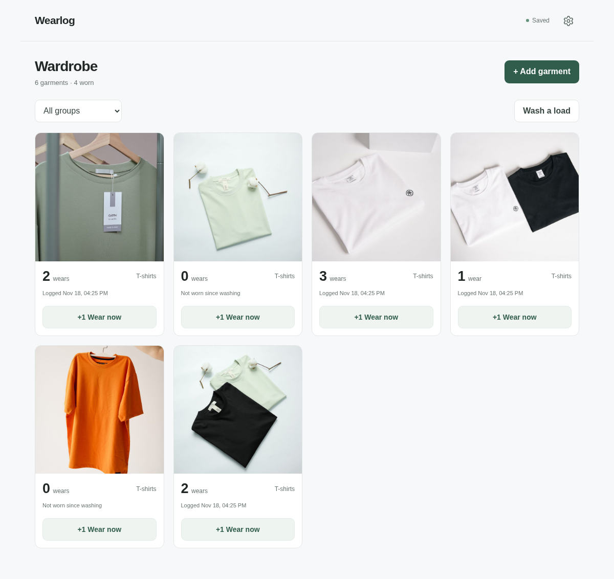
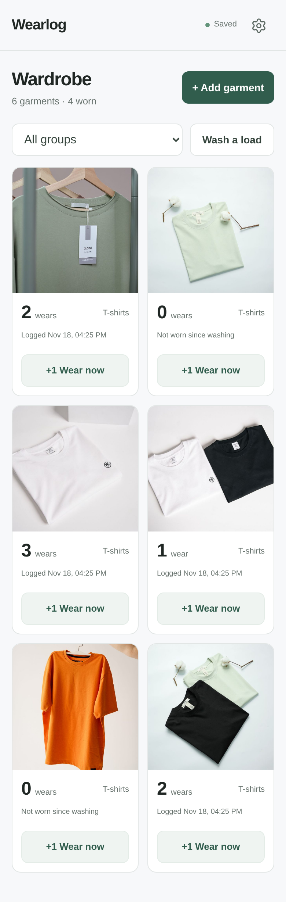
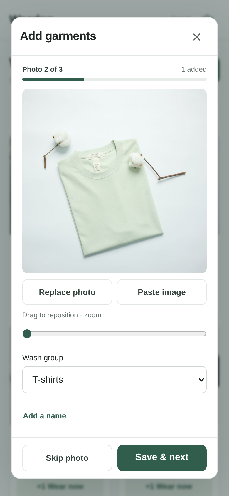

# Wearlog

Wearlog helps you remember how many times you've worn your clothes since washing them. Add a photo of each garment, tap **+1 Wear now** when you put it on, and record a wash when it's ready for a fresh start.

Install it on your phone as a progressive web app. Wears save immediately on the device, work offline, and sync across devices automatically whenever the app is open with an internet connection.

[](https://github.com/martinkozle/wearlog/actions/workflows/checks.yml)



<p>
  
  
</p>

Screenshots use a demo wardrobe. [Photo credits and screenshot generation](docs/images/CREDITS.md).

## Everyday use

- **Add a garment:** choose or paste a photo, drag and zoom to crop it, and select an existing wash group or create one. Names are optional.
- **Add several:** select multiple gallery photos, choose a group, and crop each with **Save & next**. Skip unwanted photos or stop whenever you like; saved garments are kept.
- **Log a wear:** tap **+1 Wear now** to record today's wear and the time you logged it.
- **Catch up:** open a garment to add several past wears, with an optional date.
- **Check history:** see previous entries and undo mistakes.
- **Wash a load:** select a group to preselect its worn garments, then untick anything you're leaving out.

Wearlog shows the current count so you can decide when to wash. Photos are saved as cropped 640×640 JPEGs.

## Hosting

Wearlog runs on Cloudflare:

| Service | Stores or serves |
| --- | --- |
| Worker with Static Assets | The PWA and API |
| D1 | Garments and wear/wash history |
| Private R2 bucket | Garment photos |
| Access | Sign-in and the user allowlist |
| IndexedDB on your device | Offline photos, records, and pending entries |

Code deployments preserve the database and photo bucket. See [deployment setup](DEPLOYMENT.md) for provisioning, access policies, and CI configuration.

## Install on iPhone

Open your hosted Wearlog URL in Safari, sign in, and choose **Share → Add to Home Screen**. Open the installed app online and wait for **Saved** before using it offline.

When your session expires, entries stay on the device. Tap **Sign in to sync**, complete sign-in, and the app resumes syncing. Changes sync after each action, when you return to the app, and every 30 seconds while it is open. Failed requests retry automatically. Cached records remain available offline on the device after a cloud session expires.

## Local development

Requires Node.js 22.18+ and npm. The Cloudflare CLI and local runtime are pinned in the lockfile.

```sh
git clone https://github.com/martinkozle/wearlog.git
cd wearlog
npm ci
npm run dev
```

Local development uses simulated storage and accepts local requests without cloud sign-in. The development server binds to loopback. Production API requests require a valid Cloudflare Access assertion.

To build and test:

```sh
npm run build
npm test
```

Runtime tests exercise D1 and R2 behavior, duplicate retries, transactional conflicts, pagination, and valid/invalid/expired Access tokens. For mobile browser checks, install Python Playwright and Chromium at `/usr/bin/chromium`, then run `npm run test:browser`.

## Backups

**Settings → Export wardrobe backup** saves photos and history, including pending entries on that device. Import merges entries by their identifiers. A backup should be saved before clearing browser storage, since browsers can remove local data.

For cloud backups, export D1 and copy the R2 bucket using an S3-compatible tool. Keep both together: database records reference photos by their SHA-256 hashes. D1 also provides point-in-time recovery; retention depends on the account plan.

## API and synchronization

See [API.md](API.md). Wearlog stores immutable events with stable identifiers so retries are safe. Each wash references the wears included in that load; a delayed entry from another offline device remains available for the next wash. Past wears count toward the current wash cycle. Undoing a wash from history reverses the entire load.

Photos upload separately from records. Sync uses a server cursor to fetch new events in pages, and pending entries are removed only after acknowledgment and a successful local save.

Use **Settings → Update & reload** to download the current app without clearing garments or pending entries. The installed app version is shown in Settings. If an older cached interface is stuck, open `/update` on the same hostname for the recovery page.

For frontend releases, bump `web/version.json`. The build versions the HTML, module imports, and offline shell together. New workers activate once their files download, and the app shows an update action while preserving unfinished forms.

To refresh the README screenshots using a temporary local demo wardrobe, run `python scripts/screenshots.py` after building. Photo sources and requirements are in [the image credits](docs/images/CREDITS.md).
